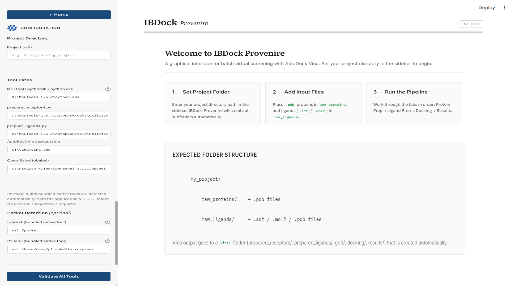
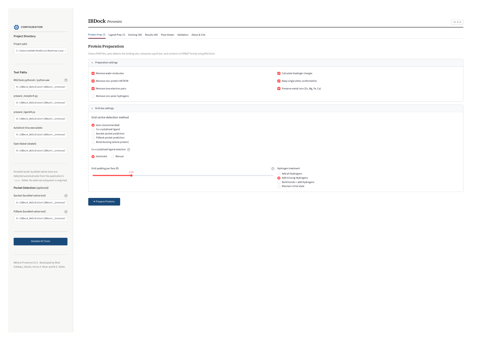
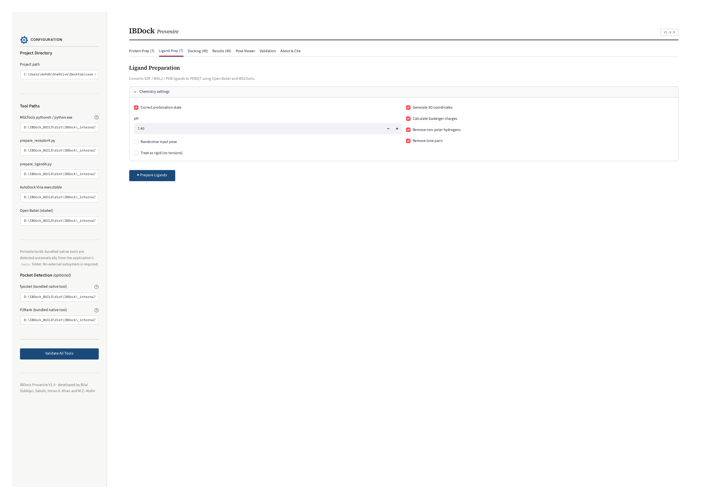
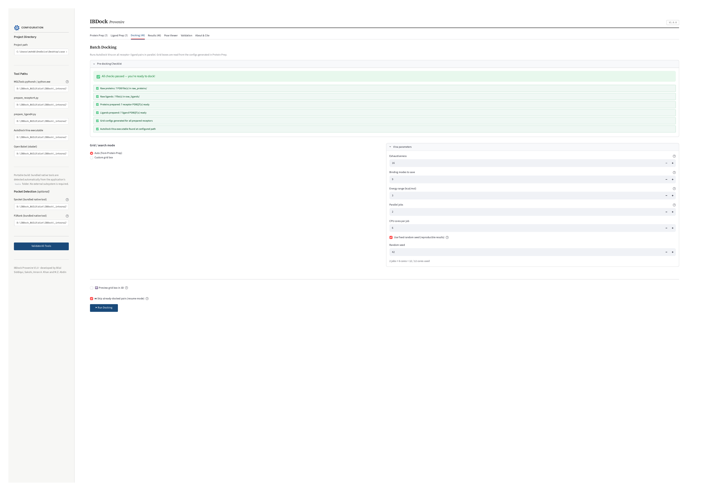
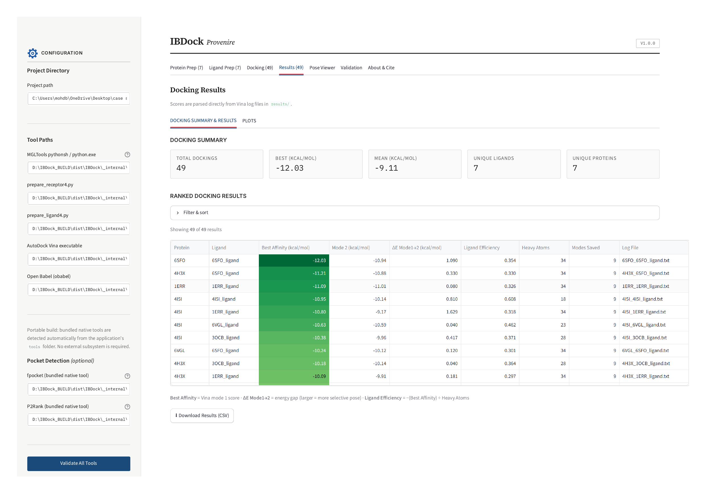
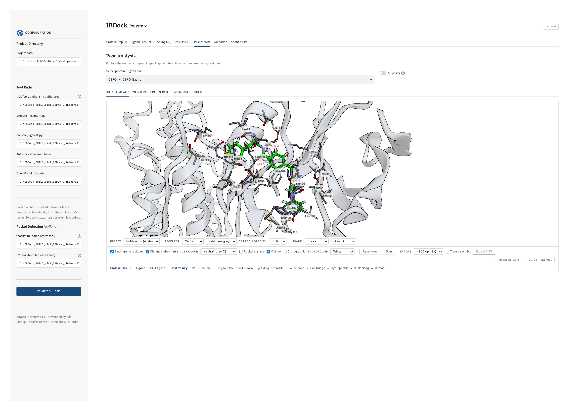
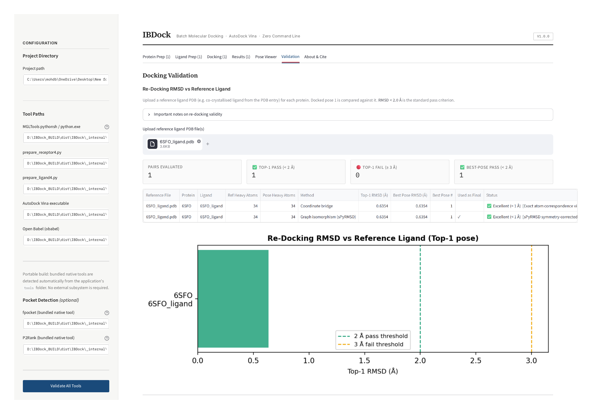
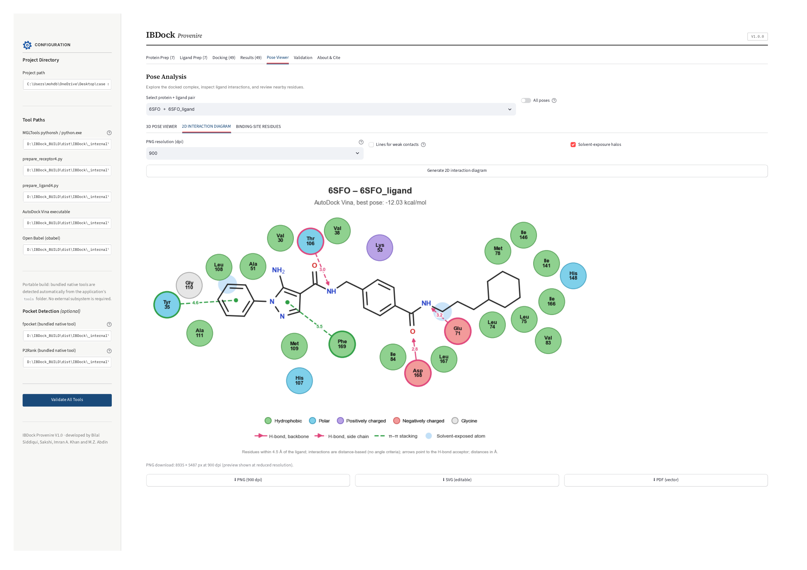
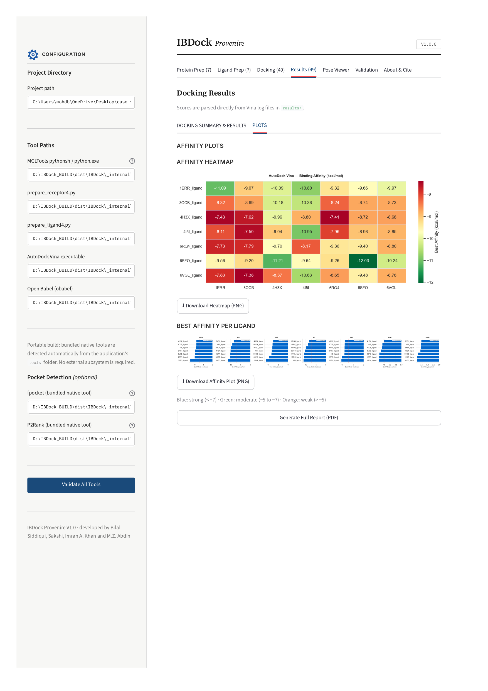

# IBDock Provenire

<!-- TODO: optional badges once the repo is live, e.g.:
[](LICENSE)
[](https://doi.org/10.5281/zenodo.XXXXXXX)
-->


**IBDock Provenire** is a browser-based graphical interface for batch molecular
docking using AutoDock Vina. It integrates the full virtual-screening
pipeline — protein preparation, ligand preparation, grid-box generation,
parallel docking, and results analysis — into a single zero-command-line
application, while recording search-space provenance as persistent project
state and validating poses through two independent atom-correspondence
routes (symmetry-aware graph correspondence via sPyRMSD, and a
provenance-aware coordinate bridge).

On the 85-complex Astex Diverse Set, four search-space strategies evaluated
under an otherwise fixed Vina protocol gave Top-1 success rates of 60.0%
(co-crystallized ligand), 51.8% (fpocket), 36.5% (P2Rank), and 23.5% (blind
docking) — demonstrating that search-space definition can materially
influence docking outcomes. See the accompanying manuscript for the full
benchmark.

## Table of Contents

- [Features](#features)
- [Screenshots](#screenshots)
- [System Requirements](#system-requirements)
- [Installation](#installation)
- [Usage](#usage)
- [Project Structure](#project-structure)
- [Reproducing the Astex Benchmark](#reproducing-the-astex-benchmark)
- [Citation](#citation)
- [License](#license)
- [Acknowledgments](#acknowledgments)

## Features

- **Automated and manual search-space selection** — a reproducible
  auto-cascade (co-crystallized ligand → P2Rank → fpocket → blind docking)
  or explicit, user-directed selection of crystallographic ligand instances.
- **Persistent search-space provenance** — every generated grid is stored
  together with the method and ligand instances that produced it
  (`grid_config.txt`, `grid_source.txt`), independently of the graphical
  interface.
- **Batch docking** with AutoDock Vina, dispatched in parallel via a
  thread-pool execution layer; configurable exhaustiveness, saved modes,
  energy range, worker count, CPU allocation, and random seed.
- **Interactive 3D pose viewer** (py3Dmol / 3Dmol.js) with a binding-site
  contact layer and exportable 2D interaction diagrams.
- **Dual-route, reference-based pose validation** — symmetry-aware graph
  correspondence (sPyRMSD) and a provenance-aware coordinate bridge; cases
  with no complete correspondence are retained as unresolved rather than
  assigned approximate mappings.
- **Downloadable PDF reports** summarizing search-space strategy, docking
  scores, and reference-based RMSD outcomes for a selected run.
- **Cross-platform**: Windows, macOS, Linux. The packaged Windows build
  bundles MGLTools, Vina, Open Babel, P2Rank, and fpocket as native Windows
  tools, with no separate installation required.

## Screenshots


*Landing page: project-directory setup, tool-path configuration, and the expected input folder structure.*

The application workflow runs across seven tabs: **Protein Prep → Ligand
Prep → Docking → Results → Pose Viewer → Validation → About & Cite**.

| | |
|---|---|
|  |  |
|  |  |
|  |  |

The Pose Viewer tab also generates publication-ready 2D ligand-interaction
diagrams, and the Results tab includes an affinity-heatmap/plots view,
both with PNG/SVG/PDF export from the same session:

| | |
|---|---|
|  |  |

## System Requirements

IBDock Provenire orchestrates several external tools that are **not**
installed via `pip` — these must be available on your system path (or
bundled, in the packaged Windows build). Versions below match the
environment used for the Astex Diverse Set benchmark reported in the
manuscript (see SI Table S3); other recent versions of these tools are
likely compatible but have not been benchmarked.

| Tool | Version used in benchmark | Role |
|---|---|---|
| Python | 3.11.9 | Application runtime |
| AutoDock Vina | 1.2.7 | Docking engine |
| MGLTools / AutoDockTools | 1.5.7 | Receptor/ligand PDBQT preparation |
| Open Babel | 3.1.1 | Chemical-format conversion |
| Meeko | 0.7.1 | Ligand-preparation fallback (on MGLTools failure) |
| P2Rank | 2.5.1 | Pocket prediction |
| fpocket | 4.0 | Pocket prediction |

<!-- TODO: add download/install links for each external tool above, e.g.:
- AutoDock Vina: https://vina.scripps.edu/
- MGLTools: https://ccsb.scripps.edu/mgltools/
- Open Babel: https://openbabel.org/
- P2Rank: https://github.com/rdk/p2rank
- fpocket: https://github.com/Discngine/fpocket
-->

## Installation

### Option 1 — Packaged Windows build (no setup required)

<!-- TODO: PLACEHOLDER — link to the portable Windows archive once uploaded
     to the GitHub release / Zenodo archive, per the manuscript's Data and
     Software Availability section. -->

Download the portable Windows archive from the
[latest release](TODO: release URL) and run `IBDock_Suite.exe` (or the
standalone app executable) directly — MGLTools, Vina, Open Babel, P2Rank,
and fpocket are bundled.

### Option 2 — Run from source (Windows / macOS / Linux)

```bash
git clone https://github.com/mohdbilalsiddiqui927/IBDock.git
cd IBDock
pip install -r requirements.txt
```

Then install the external tools listed in
[System Requirements](#system-requirements) separately and ensure they are
reachable on your system path (or configure their paths from within the
app — tool paths are persisted in `IBDock_config.json`).

## Usage

```bash
streamlit run IBDock_Provenire_1.py
```

<!-- TODO: confirm this is the correct entry-point filename/path for the
     published repository — update if the script is renamed or moved into
     a subfolder (e.g. src/IBDock_Provenire.py). If the suite launcher
     (IBDock_Suite.py) is the intended entry point instead, replace the
     command above accordingly. -->

This opens IBDock Provenire in your default web browser. Enter your project
directory path in the sidebar — IBDock Provenire creates all required
subfolders automatically.

## Project Structure

Each screening campaign is represented by a project directory containing:

```
<project_dir>/
├── IBDock_config.json      # persisted tool paths
├── grid_config.txt         # per-protein grid definition (Vina-compatible)
├── grid_source.txt         # search-space method, selection mode, ligand labels
├── dock/                   # docking-stage configs and outputs
├── grid/                   # pocket-prediction scratch outputs (P2Rank/fpocket runs)
└── ...                     # prepared structures, logs, result tables
```

## Reproducing the Astex Benchmark

<!-- TODO: fill in once the benchmark scripts/dataset are finalized in the
     repository, e.g. a `benchmark/` folder with the Astex Diverse Set
     protocol, statistical-analysis scripts, and the 85×4 dataset referenced
     in the manuscript's Supporting Information (Table S2). -->

The complete 85×4 Astex Diverse Set benchmark dataset, statistical-analysis
inputs and scripts, and the exact external-tool version identifiers used in
the manuscript are available at `TODO: path within this repo, e.g. benchmark/`.

## Citation

If you use IBDock Provenire in published research, see
[`CITATION.cff`](CITATION.cff) or cite:

<!-- TODO: update once the manuscript is accepted/published — see the
     preferred-citation block in CITATION.cff for the same TODO. -->

> Siddiqui B., Tiwari S., Khan I. A., Abdin M. Z. IBDock Provenire:
> Search-Space Capture and Pose Validation for Molecular Docking.
> *J. Chem. Inf. Model.* (in review).

IBDock Provenire orchestrates several third-party tools. If you use it in
published research, please also cite the underlying tools it depends on:

<details>
<summary>AutoDock Vina</summary>

```
Eberhardt J, Santos-Martins D, Tillack AF, Forli S. (2021).
AutoDock Vina 1.2.0: New Docking Methods, Expanded Force Field,
and Python Bindings. J Chem Inf Model. 61(8):3891-3898.
DOI: 10.1021/acs.jcim.1c00203

Trott O, Olson AJ. (2010). AutoDock Vina: Improving the speed
and accuracy of docking with a new scoring function, efficient
optimization, and multithreading. J Comput Chem. 31(2):455-461.
DOI: 10.1002/jcc.21334
```
</summary>
</details>

<details>
<summary>MGLTools / AutoDockTools</summary>

```
Morris GM, Huey R, Lindstrom W, Sanner MF, Belew RK, Goodsell DS, Olson AJ. (2009).
AutoDock4 and AutoDockTools4: Automated docking with selective receptor flexibility.
J Comput Chem. 30(16):2785-2791. DOI: 10.1002/jcc.21256
```
</details>

<details>
<summary>Open Babel</summary>

```
O'Boyle NM, Banck M, James CA, Morley C, Vandermeersch T, Hutchison GR. (2011).
Open Babel: An open chemical toolbox. J Cheminform. 3:33.
DOI: 10.1186/1758-2946-3-33
```
</details>

<details>
<summary>P2Rank</summary>

```
Krivák R, Hoksza D. (2018). P2Rank: machine learning based tool
for rapid and accurate prediction of ligand binding sites from
protein structure. J Cheminform. 10:39. DOI: 10.1186/s13321-018-0285-8
```
</details>

<details>
<summary>fpocket</summary>

```
Le Guilloux V, Schmidtke P, Tuffery P. (2009). Fpocket: An open
source platform for ligand pocket detection. BMC Bioinformatics. 10:168.
DOI: 10.1186/1471-2105-10-168
```
</details>

## License

IBDock Provenire is released under the [MIT License](LICENSE).

AutoDock Vina, MGLTools, Open Babel, P2Rank, and fpocket are each subject to
their own respective licenses — see each tool's own repository/distribution
for terms.

## Acknowledgments

Developed by Bilal Siddiqui, Sakshi Tiwari, Imran A. Khan, and M. Z. Abdin
(Jamia Hamdard, New Delhi). The authors thank Jamia Hamdard for providing
resources and facilities.
